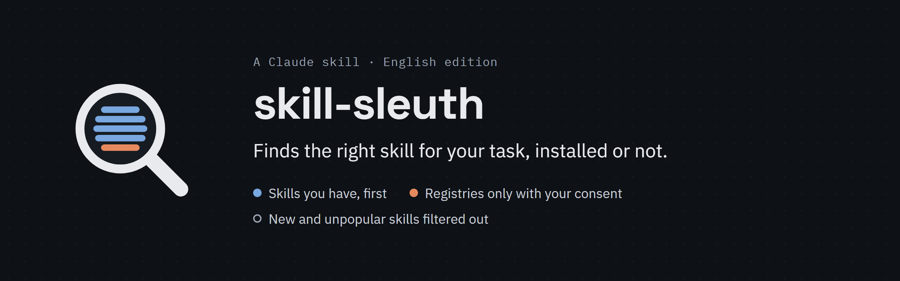
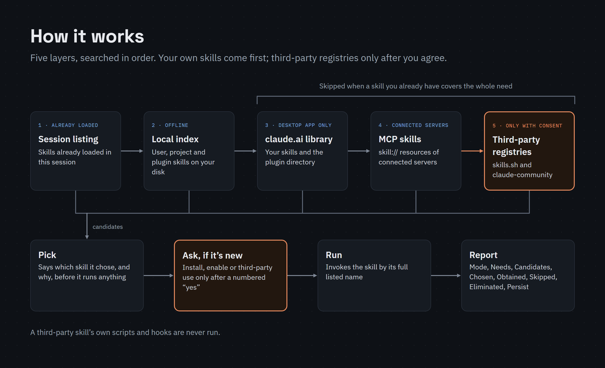
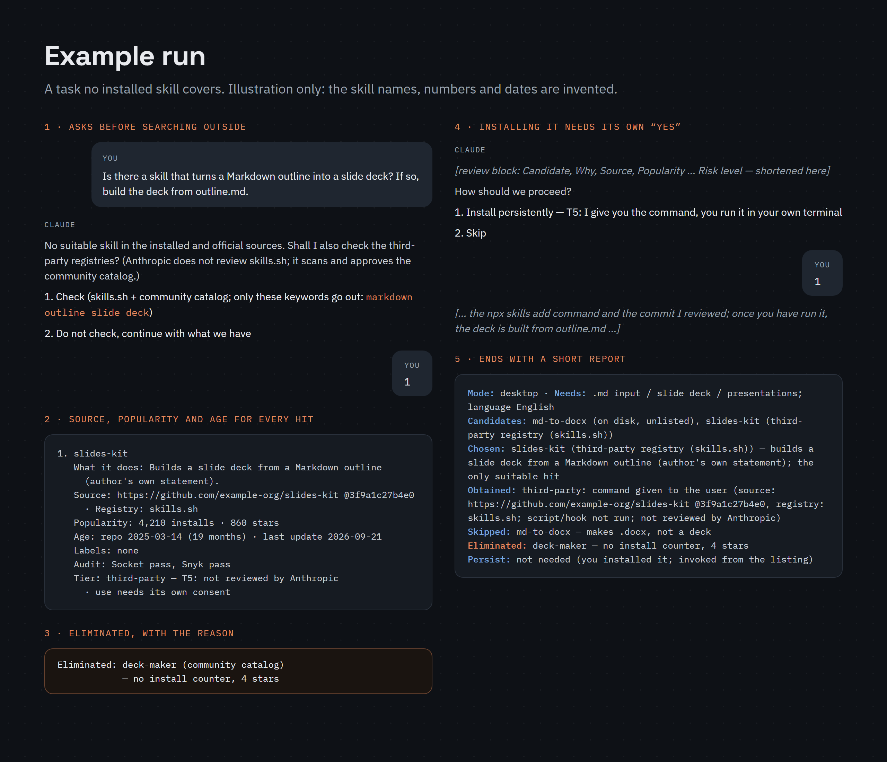
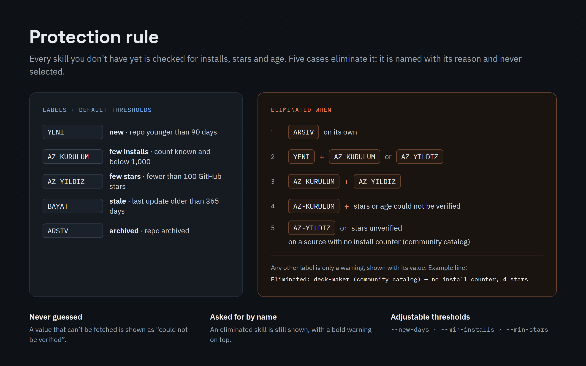
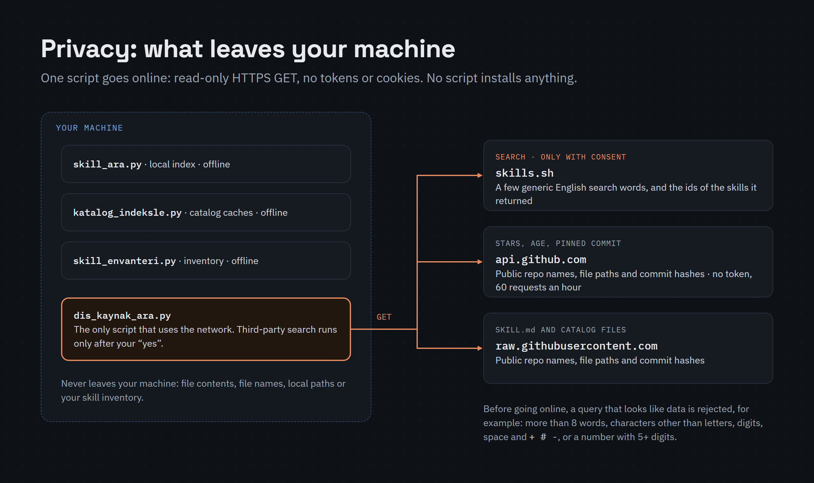

# skill-sleuth / skill-bulucu



[](LICENSE) [](https://github.com/ssakkaya/skill-sleuth/releases) 

**Türkçe:** [README.tr.md](README.tr.md)

A Claude skill that finds the right skill for your task, installed or not. Skills you already have are used right away; anything new is installed only after you answer "yes" to a numbered question.

- It checks what you already have first. Third-party registries (skills.sh and Anthropic's community plugin catalog, `claude-community`) are searched only with your consent.
- For every skill or plugin candidate that is not installed it shows what it does, its source repo and pinned commit, install count, GitHub stars and age.
- New and unpopular skills are filtered out and never recommended.
- It never runs a third-party skill's own scripts or hooks.

## Pick one edition

| Edition | Written in | Skill name after a plugin install |
|---|---|---|
| `skill-sleuth` | English | `skill-sleuth:skill-sleuth` |
| `skill-bulucu` | Turkish | `skill-bulucu:skill-bulucu` |

Both work the same way and reply in the language you write in. **Install only one.** Two copies would compete for the same tasks, and nothing in Claude Code stops you from installing both.

## Requirements

- Claude Code (not needed for the claude.ai upload). Tested on Windows 11 (desktop app and CLI). The macOS and Linux paths were tested only with synthetic folders.
- Python 3.9 or later. Standard library only; tested with 3.12. The skill tries `python`, then `python3`, then (on Windows) `py -3`; if `python` is Python 2 (some macOS and Linux systems), it uses `python3`. On Windows the Microsoft Store alias may answer as `python` without being Python; if only the `py` launcher works, the skill calls its scripts with `py -3`. Check with `python --version` (on Windows also `py -3 --version`). Without any Python 3.9 or later it skips the local index (layer 2), third-party search (layer 5) and the star/age check, goes on with the other layers and says so on the Skipped line of its report.
- Layer 3 (below) needs the Claude Desktop app's Code tab, or claude.ai chat where its tools are offered (its connector directory search was observed only in the Code tab). Third-party search and the star/age check need network access and run only in Claude Code.

## Install

### Claude Code (recommended)

In a terminal:

```bash
claude plugin marketplace add ssakkaya/skill-sleuth
claude plugin install skill-sleuth@skill-sleuth
```

For the Turkish edition, install `skill-bulucu@skill-sleuth` instead (`@skill-sleuth` is the marketplace name, the same for both). The default scope is `user`, all your projects. `--scope local` limits it to you in the current repo; `--scope project` turns it on for everyone who uses the repo.

Or inside a Claude Code session:

```
/plugin marketplace add ssakkaya/skill-sleuth
/plugin install skill-sleuth@skill-sleuth
```

`/plugin install` opens a panel where you pick the scope. Either way, the skill loads in your next session, or at once after `/reload-plugins`.

### Claude Desktop app

In the desktop app's **Code** tab, `/plugin` replies that it "isn't available in this environment", and **+ > Plugins > Add plugin** lists only plugins from marketplaces you have already added. So run the two terminal commands above once (they need the [`claude` command](https://code.claude.com/docs/en/setup)). The terminal and the desktop app's local sessions read the same settings files, so the plugin is in your next Code session. Turn it off or remove it under **+ > Plugins > Manage plugins**.

### `npx skills` (Vercel's community CLI)

Needs Node.js 22.20+ and git. Always name the edition with `--skill`:

```bash
npx skills add ssakkaya/skill-sleuth --skill skill-sleuth -a claude-code -g
```

Use `--skill skill-bulucu` for the Turkish edition. `--all`, or `-y` without `--skill`, installs both editions. By default `~/.claude/skills/<name>/` is a symlink to the copy `npx skills` keeps; add `--copy` to copy the files there instead. Use this or the plugin, not both.

### claude.ai

1. Turn on **Settings > Capabilities > Code execution and file creation**. On Team and Enterprise plans the organization must also allow code execution and skills (on by default for Team; an Owner turns them on for Enterprise).
2. Download one zip from the latest release: [skill-sleuth.zip](https://github.com/ssakkaya/skill-sleuth/releases/latest/download/skill-sleuth.zip) (English) or [skill-bulucu.zip](https://github.com/ssakkaya/skill-sleuth/releases/latest/download/skill-bulucu.zip) (Turkish). Do not unzip it.
3. Open **Customize > Skills**, click **+ > Create skill > Upload a skill**, choose the zip, then turn the skill on.

In claude.ai chat (on the web and in the desktop app's chat) the skill runs none of its scripts: it does not scan your computer or search third-party registries there. It can still use your claude.ai library (layer 3) when those tools are offered, and its report starts with "Mode: claude.ai chat".

In claude.ai and in the Claude desktop app's chat, Claude usually picks a task skill (pdf, xlsx, slides …) directly and does not start skill-sleuth on its own (observed 2026-10). To use it there, name it in your message, for example: "Use skill-sleuth: is there a skill for checking KiCad PCB files?" In Claude Code it starts on its own when you ask which skill fits, or when no listed skill covers the task.

Skills you turn on in claude.ai also load in Claude Code when you sign in with the same account (Claude Code 2.1.273 or later). If you upload it there, do not also install the plugin, or you will have two copies.

### Try it without installing

```bash
git clone https://github.com/ssakkaya/skill-sleuth
claude --plugin-dir skill-sleuth/plugins/skill-sleuth
```

## Update and remove

Auto-update is off by default for third-party marketplaces, so update by hand:

```bash
claude plugin marketplace update skill-sleuth
claude plugin update skill-sleuth@skill-sleuth
```

Remove it with `claude plugin uninstall skill-sleuth@skill-sleuth`, then `claude plugin marketplace remove skill-sleuth`. If you installed with `--scope project` or `--scope local`, add the same flag to `update` and `uninstall`. Updates load in your next session.

With `npx skills`: `npx skills update skill-sleuth -g` and `npx skills remove skill-sleuth -g`. On claude.ai, manage it under **Customize > Skills**.

Removing the skill leaves the scripts' cache behind (`%TEMP%\skill-sleuth` on Windows, `~/.cache/skill-sleuth` on macOS/Linux). Delete it yourself:

```powershell
# Windows (PowerShell)
Remove-Item -Recurse -Force "$env:TEMP\skill-sleuth"
```

```bash
# macOS, Linux
rm -rf "${XDG_CACHE_HOME:-$HOME/.cache}/skill-sleuth"
```

## How it works



It runs when you ask which skill or plugin fits a task (or to find or install one), and when a task needs a file format, tool or service that none of the skills in your session's listing covers. It searches five layers in order; when a skill already in this session's listing covers the whole need, it skips layers 3 to 5, except layer 3's connector directory search:

1. **Session listing**: skills already loaded in this session.
2. **Local index**: `scripts/skill_ara.py` scans your disk offline (user, project and plugin skills, catalog caches, built-ins).
3. **Your claude.ai library**: your claude.ai skills and the plugin directory, plus the connector directory when the task needs a service that no tool in this session covers (Claude Desktop Code tab, and claude.ai chat when its tools are offered). You connect a suggested connector yourself, from its card.
4. **MCP skills**: `skill://` resources of connected servers.
5. **Third-party registries**: skills.sh and `claude-community` through `scripts/dis_kaynak_ara.py`, **only with your consent**.

It says which skill it picked and why, runs it, and ends with a short report: Mode, Needs, Candidates, Chosen, Obtained, Skipped, Eliminated, Persist.



<details>
<summary><b>Protection rule</b>: which candidates are filtered out</summary>



| Label | Default condition |
|---|---|
| `YENI` (new) | repo younger than 90 days |
| `AZ-KURULUM` (few installs) | install count known and below 1,000 |
| `AZ-YILDIZ` (few stars) | fewer than 100 GitHub stars |
| `BAYAT` (stale) | last update older than 365 days |
| `ARSIV` (archived) | repo archived |

A candidate is eliminated (named on an "Eliminated:" line with its reason, never selected) when it is `ARSIV`; `YENI` with `AZ-KURULUM` or `AZ-YILDIZ`; `AZ-KURULUM` with `AZ-YILDIZ`; `AZ-KURULUM` while stars or age cannot be fetched; or `AZ-YILDIZ` or stars unverified on a source with no install counter (e.g. the community catalog). A single label is only a warning. Values that cannot be fetched are shown as "could not be verified", never guessed. If you ask for an eliminated skill by name, it is still shown, with a bold warning. The `YENI`, `AZ-KURULUM` and `AZ-YILDIZ` thresholds can be changed with flags of `dis_kaynak_ara.py` (`--new-days`, `--min-installs`, `--min-stars`).

A claude.ai connector (not a skill) is shown with its server host instead; the directory gives no publisher, popularity or age, so it is not filtered.
</details>

<details>
<summary><b>Privacy</b>: what leaves your machine</summary>



Only `scripts/dis_kaynak_ara.py` uses the network; the other scripts never do. It sends read-only HTTPS GET requests, without tokens or cookies, to three hosts:

- `skills.sh`: a few generic English search words, and the ids of skills it returned;
- `api.github.com` and `raw.githubusercontent.com`: public repository names, file paths and commit hashes.

The star/age check for a not-installed catalog, claude.ai or dependency candidate, or for a repository you name to install, runs without asking, only in a task where you asked about skills or plugins; only its public repo name goes out. No file contents, file names, local paths or inventory are sent to these hosts. The script rejects queries that look like data (shorter than 2 or longer than 80 characters; more than 8 words; characters other than letters, digits, space and `+ # -`; a number with 5 or more digits; more than 6 digits in all; or more than one all-digit word) before going online. Cache: `%TEMP%\skill-sleuth` on Windows (inside your per-user temp folder), `~/.cache/skill-sleuth` on macOS/Linux (`$XDG_CACHE_HOME/skill-sleuth` if set; created as 0700, and the scripts refuse a cache folder or file that is not yours or that others can write). The scripts never write into the skill folder or a Claude config tree (`.claude`), never install anything and start no other program (no `npx`, `claude` or `git`).

Claude itself, not a script, may read more public data while it reviews a candidate before an install: the candidate's manifest files at a pinned commit from `raw.githubusercontent.com`, a directory listing from `api.github.com` and its skills.sh audit entry; only with your permission it makes a shallow sparse clone from the candidate's git host into the session's temporary folder. When the session offers them, layer 3 sends a few search words to claude.ai's `SearchSkills` / `SearchPlugins` and, when a task needs a service that no tool in the session covers, at most 4 English words once per task (the service's public product name and one generic noun; the name of an internal or private system is left out; never personal data, names of people, customers or projects, file names, paths, URLs or e-mail addresses) to claude.ai's connector directory search. For a matching connector that is not connected, Claude may show one card; Claude never connects it itself or handles its credentials. You click Connect; the service may show its own permission screen, where you approve the permissions (unverified; only the card was observed). Once connected, the connector's server can read and act on (write or delete in) your account on that service, within the permissions you approve. After a numbered yes `claude plugin install` / `marketplace add` download from the plugin's source. Each plugin folder's README lists every request, every file written and how long data is kept.
</details>

## Limits

- On its own it starts only when a task needs something none of your listed skills covers; otherwise it waits for you to ask. To turn it off entirely, disable the plugin: `claude plugin disable skill-sleuth@skill-sleuth`.
- GitHub is queried without a token: 60 requests per hour per IP address. Repo data is cached for 7 days; when the limit is hit, stars and age show as "could not be verified", and community-catalog candidates are eliminated.
- **Unattended runs.** In `claude -p`, Agent SDK, scheduled-task, routine, workflow or subagent runs nobody can answer, so it asks nothing, installs or enables nothing, skips third-party search and shows no connector card (one connector directory search may still run, only to name a connector on the report's Persist line). It uses only skills already available and lists what it would have proposed under Persist.
- **Permission prompts.** In the default permission mode (Manual), Claude Code asks before each shell command, so each run of the skill's scripts shows a prompt. To stop them, pick "Yes, and don't ask again" on the prompt (kept for that command in that repository) or write an allow rule, see [Configure permissions](https://code.claude.com/docs/en/permissions).
- **If it stops starting on its own.** With many skills installed, Claude Code drops descriptions from its skill listing, least-used first, and Claude can no longer match this skill to your task. Call it by name: `/skill-sleuth:skill-sleuth <your task>` (`/skill-sleuth` for an `npx skills` copy).
- **This skill fails its own rule at first.** A new repo with few stars and installs would be eliminated if found through a registry. Install it from this page, by name.
- Its recommendations are advice, not a security audit. A community-catalog plugin is installed by Claude only after two separate numbered yeses; a skills.sh install command you run yourself.

## Issues, security, license

- Bugs: [open an issue](https://github.com/ssakkaya/skill-sleuth/issues/new/choose) with your OS, Claude Code version and Python version. Remove local paths from any output you paste; they contain your user name.
- Security problems: report them privately, see [SECURITY.md](SECURITY.md).
- [MIT](LICENSE) © 2026 ssakkaya. Descriptions shown for third-party skills belong to their authors. Changes: [CHANGELOG.md](CHANGELOG.md).
