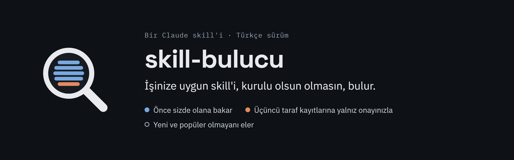
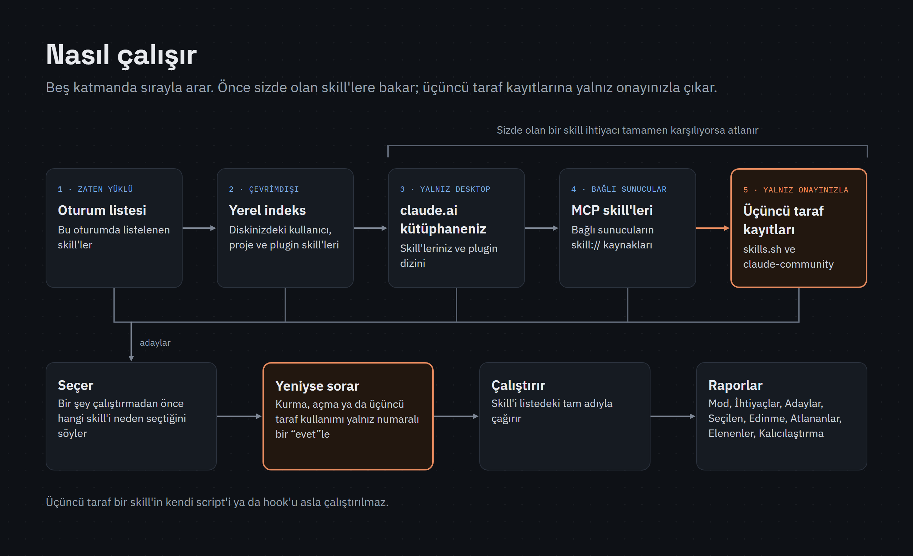
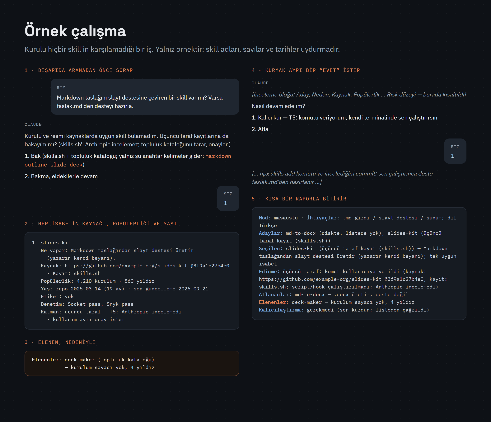
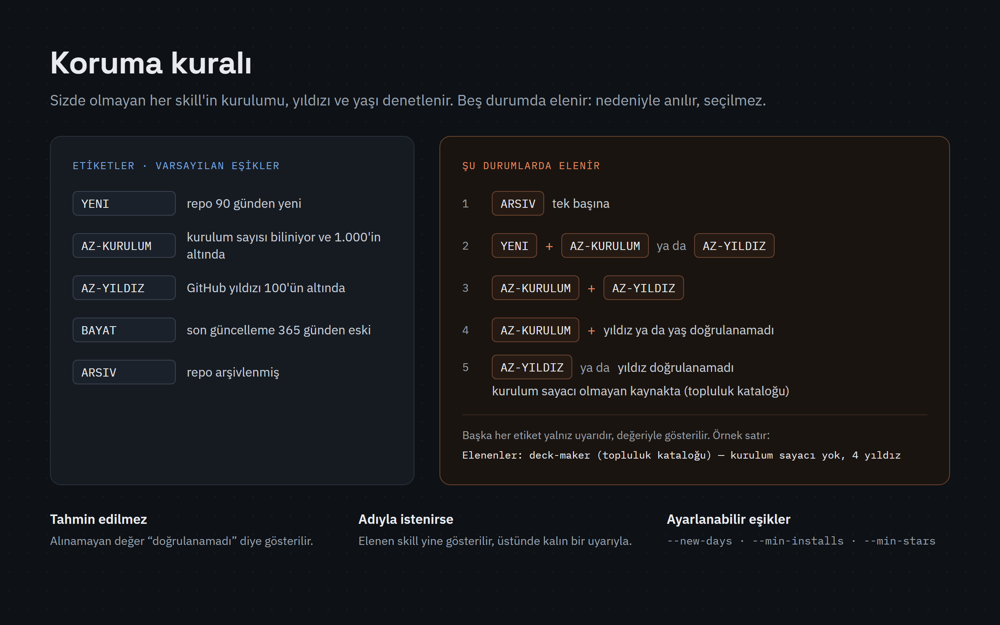
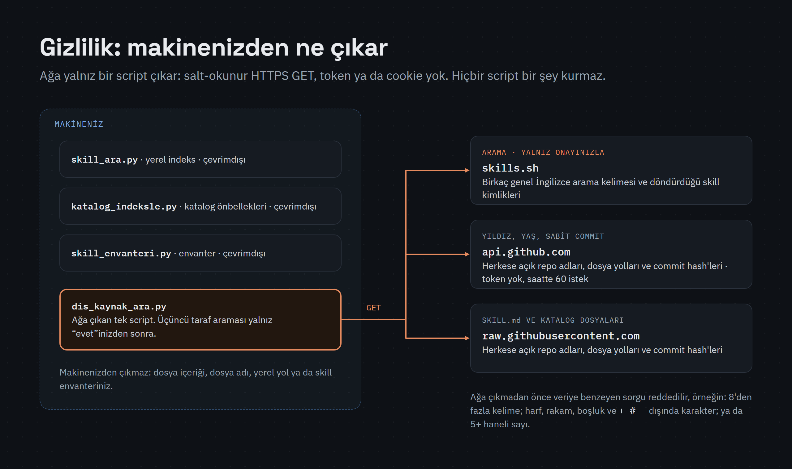

# skill-sleuth / skill-bulucu



[](LICENSE) [](https://github.com/ssakkaya/skill-sleuth/releases) 

**English:** [README.md](README.md)

İşinize uygun skill'i, kurulu olsun olmasın, bulan bir Claude skill'i. Sizde olanı hemen kullanır; yeni bir şeyi kurmak için numaralı bir soruya "evet" demenizi bekler.

- Önce sizde zaten olana bakar. Üçüncü taraf kayıtlarında (skills.sh ve Anthropic'in topluluk plugin kataloğu `claude-community`) yalnız onayınızla arar.
- Kurulu olmayan her skill ya da plugin adayının ne yaptığını, kaynak reposunu ve sabit commit'ini, kurulum sayısını, GitHub yıldızını ve yaşını gösterir.
- Yeni ve popüler olmayan skill'leri eler, önermez.
- Üçüncü taraf skill'in kendi script'ini ya da hook'unu asla çalıştırmaz.

## Tek dil sürümü seçin

| Dil sürümü | Yazıldığı dil | Plugin olarak kurulunca skill adı |
|---|---|---|
| `skill-bulucu` | Türkçe | `skill-bulucu:skill-bulucu` |
| `skill-sleuth` | İngilizce | `skill-sleuth:skill-sleuth` |

İkisi de aynı biçimde çalışır ve sizin yazdığınız dilde yanıt verir. **Yalnız birini kurun.** İki kopya aynı işler için yarışır ve Claude Code ikisini birden kurmanızı engellemez.

## Gereksinimler

- Claude Code (claude.ai yüklemesi için gerekmez). Windows 11'de sınandı (masaüstü uygulaması ve CLI). macOS ve Linux yolları yalnız sentetik klasörlerle sınandı.
- Python 3.9 ya da üstü. Yalnız standart kütüphane; 3.12 ile sınandı. Skill sırayla `python`, `python3` ve (Windows'ta) `py -3` dener; `python` Python 2 ise (bazı macOS ve Linux sistemlerinde) `python3`'ü kullanır. Windows'ta Microsoft Store kısayolu Python olmadığı hâlde `python` diye yanıt verebilir; yalnız `py` başlatıcısı çalışıyorsa skill script'lerini `py -3` ile çağırır. `python --version` ile (Windows'ta `py -3 --version` ile de) bakın. Hiç Python 3.9 ya da üstü yoksa yerel indeksi (2. katman), üçüncü taraf aramasını (5. katman) ve yıldız/yaş kontrolünü atlar, öteki katmanlarla sürer ve bunu raporunun Atlananlar satırında söyler.
- 3. katman (aşağıda) Claude Desktop uygulamasının Code sekmesini ya da araçlarının sunulduğu claude.ai sohbetini ister (konektör dizini araması yalnız Code sekmesinde gözlendi). Üçüncü taraf araması ve yıldız/yaş kontrolü ağ erişimi ister ve yalnız Claude Code'da çalışır.

## Kurulum

### Claude Code (önerilen)

Terminalde:

```bash
claude plugin marketplace add ssakkaya/skill-sleuth
claude plugin install skill-bulucu@skill-sleuth
```

İngilizce sürüm için `skill-sleuth@skill-sleuth` kurun (`@skill-sleuth` marketplace adıdır, iki sürümde de aynı). Varsayılan kapsam `user`'dır, yani tüm projeleriniz. `--scope local` yalnız sizin için bu repoyla sınırlar; `--scope project` bu repoyu kullanan herkes için açar.

Ya da bir Claude Code oturumunun içinde:

```
/plugin marketplace add ssakkaya/skill-sleuth
/plugin install skill-bulucu@skill-sleuth
```

`/plugin install` kapsamı seçeceğiniz bir panel açar. Her iki yolda da skill bir sonraki oturumda, ya da `/reload-plugins` sonrasında hemen yüklenir.

### Claude Desktop uygulaması

Masaüstü uygulamasının **Code** sekmesinde `/plugin` "isn't available in this environment" yanıtını verir; **+ > Plugins > Add plugin** de yalnız önceden eklenmiş marketplace'lerdeki plugin'leri listeler. Bu yüzden yukarıdaki iki terminal komutunu bir kez çalıştırın (bunun için [`claude` komutu](https://code.claude.com/docs/en/setup) gerekir). Terminal ve masaüstü uygulamasının yerel oturumları aynı ayar dosyalarını okur; plugin bir sonraki Code oturumunda hazırdır. Kapatmak ya da kaldırmak için **+ > Plugins > Manage plugins**.

### `npx skills` (Vercel'in topluluk aracı)

Node.js 22.20+ ve git gerekir. Kuracağınız skill'in adını her zaman `--skill` ile verin:

```bash
npx skills add ssakkaya/skill-sleuth --skill skill-bulucu -a claude-code -g
```

İngilizce sürüm için `--skill skill-sleuth` yazın. `--all` ile ya da `--skill` vermeden `-y` ile kurarsanız iki dil sürümü birden kurulur. Varsayılan olarak `~/.claude/skills/<ad>/`, `npx skills`'in tuttuğu kopyaya giden bir sembolik bağlantıdır (symlink); dosyaların oraya kopyalanması için `--copy` ekleyin. Bunu ya da plugin'i kullanın, ikisini birden değil.

### claude.ai

1. **Settings > Capabilities > Code execution and file creation** ayarını açın. Team ve Enterprise planlarında kuruluşun da kod çalıştırmaya ve skill'lere izin vermesi gerekir (Team'de varsayılan olarak açık; Enterprise'da bir Owner açar).
2. Son sürümden tek bir zip indirin: [skill-bulucu.zip](https://github.com/ssakkaya/skill-sleuth/releases/latest/download/skill-bulucu.zip) (Türkçe) ya da [skill-sleuth.zip](https://github.com/ssakkaya/skill-sleuth/releases/latest/download/skill-sleuth.zip) (İngilizce). Zip'i açmayın.
3. **Customize > Skills** sayfasında **+ > Create skill > Upload a skill** ile zip'i seçin, sonra skill'i açın.

claude.ai sohbetinde (web'de ve masaüstü uygulamasının sohbetinde) skill hiçbir script'ini çalıştırmaz: orada bilgisayarınızı taramaz, üçüncü taraf kayıtlarında arama yapmaz. Araçları sunulduğunda claude.ai kütüphanenizi (3. katman) yine kullanabilir; raporu "Mod: claude.ai chat" ile başlar.

claude.ai'de ve Claude masaüstü uygulamasının sohbetinde Claude, işe uygun skill'i (pdf, xlsx, sunum …) çoğu zaman doğrudan seçer ve skill-bulucu'yu kendiliğinden başlatmaz (2026-10'da gözlendi). Orada kullanmak için mesajınızda adını yazın, örneğin: "skill-bulucu ile: KiCad PCB dosyalarını denetleyen bir skill var mı?" Claude Code'da, hangi skill'in uyduğunu sorduğunuzda ya da listedeki hiçbir skill işi karşılamadığında kendiliğinden başlar.

claude.ai'de açtığınız skill'ler, aynı hesapla oturum açtığınızda Claude Code'da da yüklenir (Claude Code 2.1.273 ya da sonrası). Skill'i oraya yüklediyseniz plugin'i ayrıca kurmayın, yoksa iki kopya olur.

### Kurmadan deneyin

```bash
git clone https://github.com/ssakkaya/skill-sleuth
claude --plugin-dir skill-sleuth/plugins/skill-bulucu
```

## Güncelleme ve kaldırma

Üçüncü taraf marketplace'lerde otomatik güncelleme varsayılan olarak kapalıdır, elle güncelleyin:

```bash
claude plugin marketplace update skill-sleuth
claude plugin update skill-bulucu@skill-sleuth
```

Kaldırmak için `claude plugin uninstall skill-bulucu@skill-sleuth`, ardından `claude plugin marketplace remove skill-sleuth` çalıştırın. `--scope project` ya da `--scope local` ile kurduysanız `update` ve `uninstall` komutlarına aynı bayrağı ekleyin. Güncelleme bir sonraki oturumda yüklenir.

`npx skills` ile: `npx skills update skill-bulucu -g` ve `npx skills remove skill-bulucu -g`. claude.ai'de **Customize > Skills** sayfasından yönetin.

Skill'i kaldırmak script'lerin önbelleğini silmez (Windows'ta `%TEMP%\skill-sleuth`, macOS/Linux'ta `~/.cache/skill-sleuth`). Kendiniz silin:

```powershell
# Windows (PowerShell)
Remove-Item -Recurse -Force "$env:TEMP\skill-sleuth"
```

```bash
# macOS, Linux
rm -rf "${XDG_CACHE_HOME:-$HOME/.cache}/skill-sleuth"
```

## Nasıl çalışır



Bir işe hangi skill ya da plugin'in uyduğunu sorduğunuzda (ya da birini bulmasını, kurmasını istediğinizde) ve bir iş, oturum listenizdeki hiçbir skill'in karşılamadığı bir dosya biçimi, araç ya da servis gerektirdiğinde devreye girer. Beş katmanda sırayla arar; oturum listesindeki bir skill ihtiyacın tamamını karşılıyorsa 3-5. katmanları atlar, 3. katmanın konektör dizini araması hariç:

1. **Oturum listesi**: bu oturumda zaten yüklü skill'ler.
2. **Yerel indeks**: `scripts/skill_ara.py` diskinizi çevrimdışı tarar (kullanıcı, proje ve plugin skill'leri, katalog önbellekleri, built-in'ler).
3. **claude.ai kütüphaneniz**: claude.ai'deki skill'leriniz ve plugin dizini; iş, bu oturumdaki hiçbir aracın karşılamadığı bir servis gerektiriyorsa konektör dizini de (Claude Desktop Code sekmesinde; araçları sunulduğunda claude.ai sohbetinde de). Önerilen bir konektörü siz, kartından bağlarsınız.
4. **MCP skill'leri**: bağlı sunucuların `skill://` kaynakları.
5. **Üçüncü taraf kayıtları**: skills.sh ve `claude-community`, `scripts/dis_kaynak_ara.py` ile, **yalnız onayınızla**.

Hangi skill'i neden seçtiğini söyler, çalıştırır ve kısa bir raporla bitirir: Mod, İhtiyaçlar, Adaylar, Seçilen, Edinme, Atlananlar, Elenenler, Kalıcılaştırma.



<details>
<summary><b>Koruma kuralı</b>: hangi adaylar elenir</summary>



| Etiket | Varsayılan koşul |
|---|---|
| `YENI` | repo 90 günden yeni |
| `AZ-KURULUM` | kurulum sayısı biliniyor ve 1.000'in altında |
| `AZ-YILDIZ` | GitHub yıldızı 100'ün altında |
| `BAYAT` | son güncelleme 365 günden eski |
| `ARSIV` | repo arşivlenmiş |

Aday şu durumlarda elenir ("Elenenler:" satırında nedeniyle anılır, seçilmez): `ARSIV`; `YENI` ile birlikte `AZ-KURULUM` ya da `AZ-YILDIZ`; `AZ-KURULUM` ile `AZ-YILDIZ` birlikte; `AZ-KURULUM` varken yıldız ya da yaş alınamıyor; sayaçsız kaynakta (ör. topluluk kataloğu) `AZ-YILDIZ` ya da yıldız doğrulanamadı. Tek bir etiket yalnız uyarıdır. Alınamayan değer "doğrulanamadı" diye gösterilir, tahmin edilmez. Elenen bir skill'i adıyla isterseniz yine gösterilir, üstünde kalın bir uyarıyla. `YENI`, `AZ-KURULUM` ve `AZ-YILDIZ` eşikleri `dis_kaynak_ara.py` bayraklarıyla değiştirilebilir (`--new-days`, `--min-installs`, `--min-stars`).

Bir claude.ai konektörü (skill değil) bunun yerine sunucu host'uyla gösterilir; dizin yayıncı, popülerlik ya da yaş vermediği için elenmez.
</details>

<details>
<summary><b>Gizlilik</b>: makinenizden ne çıkar</summary>



Ağa yalnız `scripts/dis_kaynak_ara.py` çıkar; öteki script'ler hiç çıkmaz. Token ya da cookie göndermeden, üç host'a salt-okunur HTTPS GET isteği atar:

- `skills.sh`: birkaç genel İngilizce arama kelimesi ve onun döndürdüğü skill kimlikleri;
- `api.github.com` ve `raw.githubusercontent.com`: herkese açık repo adları, dosya yolları ve commit hash'leri.

Kurulu olmayan bir katalog, claude.ai ya da bağımlılık adayının ya da kurmak için adını verdiğiniz bir deponun yıldız/yaş kontrolü, skill ya da plugin sorduğunuz bir görevde sormadan yapılır; yalnız herkese açık repo adı gider. Bu host'lara dosya içeriği, dosya adı, yerel yol ya da envanter gönderilmez. Script veriye benzeyen sorguyu (2 karakterden kısa ya da 80 karakterden uzun; 8'den fazla kelime; harf, rakam, boşluk ve `+ # -` dışında karakter; 5 ya da daha çok haneli sayı; toplamda 6'dan fazla rakam; yalnız rakamdan oluşan birden fazla kelime) ağa çıkmadan reddeder. Önbellek: Windows'ta `%TEMP%\skill-sleuth` (kullanıcıya özel geçici klasörünüzün içinde), macOS/Linux'ta `~/.cache/skill-sleuth` (tanımlıysa `$XDG_CACHE_HOME/skill-sleuth`; 0700 izniyle oluşturulur ve script'ler sizin olmayan ya da başkalarının yazabildiği bir önbellek klasörünü veya dosyasını kullanmaz). Script'ler skill klasörüne ya da bir Claude ayar ağacına (`.claude`) yazmaz, hiçbir şey kurmaz ve başka hiçbir program başlatmaz (`npx`, `claude` ya da `git` dahil).

Claude'un kendisi de (bir script değil), kurulumdan önce bir adayı incelerken daha fazla herkese açık veriye bakabilir: adayın sabit commit'teki manifest dosyalarını `raw.githubusercontent.com`'dan, bir klasör listesini `api.github.com`'dan ve skills.sh denetim kaydını okur; yalnız izninizle adayın git sunucusundan oturumun geçici klasörüne sığ, seyrek bir klon alır. Oturum sunuyorsa 3. katman claude.ai'nin `SearchSkills` / `SearchPlugins` araçlarına birkaç arama kelimesi gönderir; bir iş, oturumdaki hiçbir aracın karşılamadığı bir servis gerektirdiğinde de görev başına bir kez, claude.ai'nin konektör dizini aramasına en çok 4 İngilizce kelime gönderir (hizmetin herkese açık ürün adı ve bir genel isim; iç ya da özel bir sistemin adı yazılmaz; kişisel veri, kişi, müşteri ya da proje adı, dosya adı, yol, URL ya da e-posta adresi asla). Uyan konektör bağlı değilse Claude tek bir kart gösterebilir; Claude onu kendisi bağlamaz, kimlik bilgilerine dokunmaz. Connect'e siz tıklarsınız; hizmet kendi izin ekranını gösterebilir, izinleri orada siz onaylarsınız (doğrulanmadı; yalnız kart gözlendi). Bağlandıktan sonra konektörün sunucusu, o hizmetteki hesabınızda onayladığınız izinler ölçüsünde veriyi okuyabilir ve işlem yapabilir (yazma ya da silme). Numaralı bir "evet"ten sonra `claude plugin install` / `marketplace add` plugin'in kaynağından indirir. Her plugin klasöründeki README; her isteği, yazılan her dosyayı ve verinin ne kadar tutulduğunu listeler.
</details>

## Sınırlar

- Kendiliğinden yalnız bir iş, listenizdeki hiçbir skill'in karşılamadığı bir şey gerektirdiğinde devreye girer; aksi halde siz sorana kadar bekler. Tamamen kapatmak için plugin'i kapatın: `claude plugin disable skill-bulucu@skill-sleuth`.
- GitHub'a token'sız gidilir: IP adresi başına saatte 60 istek. Repo bilgisi 7 gün önbellekte kalır; sınıra takılınca yıldız ve yaş "doğrulanamadı" görünür ve topluluk kataloğu adayları elenir.
- **Gözetimsiz koşular.** `claude -p`, Agent SDK, zamanlanmış görev, rutin, workflow ya da alt ajan koşularında yanıt verecek kimse yoktur; bu yüzden hiçbir şey sormaz, hiçbir şey kurmaz ya da etkinleştirmez, üçüncü taraf aramasını atlar ve konektör kartı göstermez (tek bir konektör dizini araması yine yapılabilir, yalnız bir konektörü raporun Kalıcılaştırma satırında adlandırmak için). Yalnız zaten kullanılabilen skill'leri kullanır ve önereceklerini Kalıcılaştırma satırında listeler.
- **İzin istemleri.** Varsayılan izin modunda (Manual) Claude Code her kabuk komutundan önce sorar; bu yüzden skill'in script'leri her çalıştığında bir istem görürsünüz. İstemesin diyorsanız istemde "Yes, and don't ask again" seçin (o repoda o komut için saklanır) ya da bir izin kuralı yazın, bkz. [Configure permissions](https://code.claude.com/docs/en/permissions).
- **Kendiliğinden devreye girmezse.** Çok skill kuruluysa Claude Code, en az kullanılanlardan başlayarak skill listesindeki açıklamaları düşürür; Claude bu skill'i işinizle eşleştiremez. Adıyla çağırın: `/skill-bulucu:skill-bulucu <işiniz>` (`npx skills` kopyası için `/skill-bulucu`).
- **Bu skill şimdilik kendi kuralına takılır.** Az yıldızlı, az kurulumlu yeni bir repo bir kayıtta bulunursa elenir. Bu sayfadan, adıyla kurun.
- Önerileri yalnız tavsiyedir, güvenlik denetimi değildir. Topluluk kataloğundaki bir plugin'i Claude ancak iki ayrı numaralı "evet"ten sonra kurar; skills.sh kurulum komutunu siz çalıştırırsınız.

## Sorunlar, güvenlik, lisans

- Hatalar: işletim sisteminizi, Claude Code ve Python sürümünüzü yazarak [issue açın](https://github.com/ssakkaya/skill-sleuth/issues/new/choose). Yapıştırdığınız çıktıdan yerel yolları silin; kullanıcı adınızı içerir.
- Güvenlik sorunları: gizli bildirin, bkz. [SECURITY.md](SECURITY.md).
- [MIT](LICENSE) © 2026 ssakkaya. Üçüncü taraf skill'ler için gösterilen açıklamalar yazarlarına aittir. Değişiklikler: [CHANGELOG.md](CHANGELOG.md).
